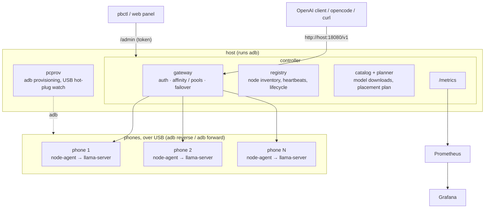

# PhoneBorg

[](https://github.com/dzaczek/phoneborg/actions/workflows/ci.yml)

**Turn a drawer full of old Android phones into an AI inference cluster.**

Plug phones into a Linux or macOS host over USB. PhoneBorg installs a small
node agent on each phone over adb; the phone benchmarks itself, joins the
cluster and serves a GGUF model with
[llama.cpp](https://github.com/ggml-org/llama.cpp). Clients talk to **one
OpenAI-compatible endpoint**. The controller decides which phone serves which
model, routes each request to a phone, fails over when one freezes, and
exports everything to Prometheus and Grafana.

> **Status: proof of concept.** It runs end to end on a production cluster of
> five phones and on emulated phones. APIs, metrics and file layout will
> change. Parts of the API are unauthenticated in v0: do not expose it to
> untrusted networks.



## Cluster modes and measured results

The same phones can work in several modes at once: some phones serve
`auto`, some form pools, others become a Super Borg or a Big Brain. Every
number below was measured on real hardware unless marked *emulated*. The
setups and methods are in [docs/BENCHMARKS.md](docs/BENCHMARKS.md), and the
pros and cons of each mode are in [docs/CONCEPTS.md](docs/CONCEPTS.md#modes-at-a-glance).

Production cluster: Pixel 8 Pro (12 GB), OnePlus 10 Pro (12 GB), POCO F3 (8 GB), Xiaomi Mi 8 (6 GB), Xiaomi MI 9 (6 GB).

| # | Mode | Request `model` | What the phones do | Best for | Headline result |
|---|---|---|---|---|---|
| 1 | [One phone per request](#1-one-phone-per-request) | model id, `auto`, `node/<alias>` | the gateway picks one phone | chat, simple clients | 29 tok/s (0.5B), ~5 tok/s (4B) |
| 1+ | [Semantic router](#semantic-router-experimental) | `auto` | one phone sorts the request into a class | mixed traffic | 11 of 12 classified right, ~2 s each |
| 2 | [Pools](#2-pools) | `pool/<name>` | many requests at once, one phone each | parallel agents | 3 tasks in 9.9 s vs 23.8 s on one phone |
| 3–4 | [Super Borg](#34-super-borg-pools) | `pool/<name>` (`superborg`) | an orchestrator splits one request across phones | multi-part answers | ~2 min for a three-part request |
| 5 | [Jobs](#5-jobs) | `pbctl jobs` | long multi-step work in the background | documents, stories | 12 documents in ~70 min on 3 phones |
| 6 | [Agent + MCP](#6-agent--mcp) | `pbctl mcp`, opencode | a strong model plans, the phones do the pieces | coding agents | as pools and jobs |
| 7 | [Model benchmark (MMB)](#7-model-benchmark-mmb) | `pbctl mmb` | each phone measures every model that fits | choosing placement | 65 results, 19 models, 4 phones |
| 8 | [Big Brain](#8-big-brain-pools) | `pool/<name>` (`bigbrain`) | the phones hold **one** model too large for any of them | 20B+ models | gpt-oss-20b at 2.8 tok/s, 30B MoE at 2.57 on 2 phones |

Modes 1–7 make the cluster do **more at once** with models that fit on one
phone. Mode 8 runs a **bigger model**, one request at a time, and takes the
phones it uses out of the other modes.

### 1. One phone per request

The gateway sends each request to the least busy, coolest phone. A session
stays on the phone that holds its prompt cache, and the gateway fails over
when a phone freezes.

| Measurement | Result |
|---|---|
| Generation, OnePlus 10 Pro: 0.5B / 1.5B / 4B / 8B (Q4_K_M) | 29.0 / 13.3 / 4.6 / 2.9 tok/s |
| Generation, Xiaomi Mi 8: 0.5B / 1.5B | 14.6 / 5.7 tok/s |
| Prompt processing, Pixel 8 Pro: 0.5B / 4B (~500 tokens) | 123.5 / 12.9 tok/s |
| opencode, new session vs follow-up turn (session affinity, *emulated*) | 115 s vs 3 s |
| Freezing a phone under load (*emulated*) | 0 failed requests of 1138 |
| Mi 8, screen off on USB power | 40 min `ACTIVE`, 40 of 40 requests served |

### Semantic router (experimental)

One phone reads each `auto` request and answers with a single token naming
its class, such as easy chat, coding or reasoning. The gateway then sends
the request to that class's pool or phone. Classes are editable in `pbctl`
and the panel.

| Classifier | Right | Per decision (cached / first) |
|---|---|---|
| Pixel 8 Pro, Qwen3-4B, 6 classes | 11 of 12 | 1.7–2.7 s / 17 s |
| Pixel 8 Pro, Qwen3-4B, easy/hard | 7 of 7 | 1.4–1.8 s / 9 s |
| Mi 8, Gemma 3n E2B, easy/hard | 7 of 7 | 30–41 s (Gemma cannot reuse the cache) |
| End to end on the cluster, one request per class | 6 of 6 routed right | 1.8–2.2 s / 17.5 s |

### 2. Pools

A pool is a named set of phones, chosen by alias, model, class or speed.
With `spread` routing, parallel requests each get their own phone.

| Three tool-less agent tasks in parallel | Wall time | Correct |
|---|---|---|
| `pool/fast`: Mi 8 (1.5B) + two *emulated* phones (0.5B) | 9.9 s | 1 of 3 |
| `node/mi8`: queued on one phone | 23.8 s | 3 of 3 |

Spreading buys speed, and the choice of members decides quality.

### 3–4. Super Borg pools

The pool answers as a single model. Its orchestrator splits the request
into subtasks and the other phones work on them in parallel. The
orchestrator can be a phone or an external desktop or API model.

| Request | Setup | Time |
|---|---|---|
| Three-part request (poem, translation, three facts) | Qwen3-4B orchestrator on the POCO, 2 workers | ~2 min |
| Same request | Qwen3-8B orchestrator on the OnePlus, 3 workers | ~6 min |

Most of the time goes to the orchestrator reading its prompt. With an
external orchestrator, only the phones' writing time remains.

### 5. Jobs

A job is long, multi-step work on a Super Borg pool, with a task list and
documents that the controller keeps.

| Job | Time |
|---|---|
| 12-document story (plan, outline, chapters) on 3 phones in parallel | ~70 min, 4 documents per phone |
| One orchestrator step, Qwen3-8B on the OnePlus, 2–3k-token prompt | 5–10 min |

### 6. Agent + MCP

With `pbctl mcp`, an agent such as opencode can use the cluster as tools:
ask a question, map tasks in parallel, vote, and run jobs. A strong main
model plans, and the phones run the pieces at pool and job speed (modes 2
and 5). `pbctl opencode` generates tool-less subagents, which need a
~182-token prompt where the default agent needs ~11.7k.

### 7. Model benchmark (MMB)

MMB loads every model that fits on the chosen phones and measures the same
things on each: load time, time to first token, prompt speed and generation
speed. The panel shows the results as a phones × models table. In the
4-phone run, 19 models produced 65 results with no failures. Full tables
are in [BENCHMARKS.md](docs/BENCHMARKS.md#multi-model-benchmark-four-phones).

### 8. Big Brain pools

A Big Brain pool runs one catalog model that is too large for any single
phone. The model is split across the RAM of several phones over llama.cpp
RPC, and the controller runs the head. Create one from the panel with
**Pools → Add Big Brain**, which shows whether the model fits. Clients use
it as `pool/<name>`.

| Model | 2 phones | 3 | 4 | 5 | Load |
|---|---|---|---|---|---|
| gpt-oss-20b MXFP4 (12.1 GB, MoE, OpenAI) | **2.6–2.8** tok/s | – | – | – | 9 min |
| Qwen3-30B-A3B Q3 (13.8 GB, MoE) | **2.57** | 2.24 | 1.96 | 1.66 | 4–11 min |
| Mistral Small 3.2 24B Q4_K_M (14.3 GB, dense) | – | 0.46–1.15 ¹ | – | – | 16 min |
| Gemma 3 27B Q4_K_M (16.5 GB, dense) | – | 0.27–1.01 ¹ | – | – | 10.5 min |
| Qwen3-32B Q4_K_M (19.8 GB, dense) | – | – | 0.89 | 0.75 | 12 min |
| Llama-3.3-70B IQ2_XXS (19.4 GB, dense 2-bit) | – | – | – | 0.21–0.30 | 12 min |

¹ Pixel, OnePlus and POCO. The speed varied between runs: the OnePlus
reached 80 °C and throttled, and with Gemma the POCO had 0.7 GB free.

Every architecture tried runs without changes: Qwen3, Qwen3 MoE, Llama,
gpt-oss, Mistral and Gemma 3. Adding phones makes the model slower,
because every token passes through the phones in sequence. Use the
fewest, largest phones the model fits on, and prefer MoE models. Full results and analysis:
[issue #6](https://github.com/dzaczek/phoneborg/issues/6) and
[BENCHMARKS.md](docs/BENCHMARKS.md#big-brain-one-model-across-phones).

## Platform features

- **Zero-touch provisioning:** `pcprov watch` provisions each phone when
  it is plugged in. It picks the fastest llama.cpp build the phone's CPU
  supports and restores dropped adb links.
- **Runtime-discovered inventory:** the agent reads each phone's SoC,
  cores, RAM, battery and temperature at runtime. Nothing is hard-coded
  per phone model.
- **Node lifecycle:** heartbeats move each phone through
  `BENCHMARKING → ACTIVE → SUSPECT → OFFLINE`, and it recovers
  automatically.
- **One OpenAI-compatible gateway:** chat and completions with streaming,
  session affinity, failover, and routing that avoids hot and slow phones.
- **Model catalog and placement:** add GGUFs from Hugging Face. Phones
  download them over USB and switch, sized to their RAM.
- **Performance tiers:** each phone's measured bandwidth predicts each
  model's speed and keeps too-slow placements away.
- **Management:** the `pbctl` CLI and a built-in web panel handle drain,
  aliases, pools, API keys (stored hashed), gateway settings, and usage
  per key and node.
- **External engine nodes:** a Mac or PC running LM Studio, oMLX, Ollama
  or llama-server can join as a node behind the same gateway.
- **Observability:** JSON logs, `phoneborg_*` metrics and a Grafana
  dashboard.
- **Test without phones:** emulated Android phones (redroid) driven
  through real adb.


More screenshots of the web panel and the Grafana dashboard: [docs/OPERATIONS.md](docs/OPERATIONS.md#screenshots).

## Quick start

**One command on Debian or Ubuntu** (a PC, a NUC or a VM with USB
passthrough). It installs everything, starts the services and prints
the panel's address. Run it as your normal user, not root:

```sh
curl -fsSL https://raw.githubusercontent.com/dzaczek/phoneborg/main/deploy/install.sh | bash -s -- host
```

Use `docker` instead of `host` to run the same cluster in Docker
containers. Then turn on USB debugging on a phone, plug it in and tap
**Allow**. You install nothing on the phone yourself: the provisioner
pushes the agent, llama.cpp and a first model over USB. Details and
settings: [docs/INSTALL.md](docs/INSTALL.md#installer).

**Step by step** instead:

- [docs/QUICKSTART.md](docs/QUICKSTART.md): a test cluster with one or two
  phones on a Linux or macOS machine, including pools, Super Borg and a job.
- [docs/INSTALL.md](docs/INSTALL.md): a permanent install as services on
  Debian or Ubuntu, with every command and config file the installer runs.

Phones: ARM64 Android with 4 GB RAM or more. Which phones and models fit:
[docs/REAL_PHONES.md](docs/REAL_PHONES.md).

**Emulated phones** with Prometheus (:9090) and Grafana (:3000), see
[docs/DEV_EMULATION.md](docs/DEV_EMULATION.md):

```sh
make agent pcprov cluster-up
make e2e                                      # provisioning, serving, failover, recovery
```

## Documentation

| Document | For |
|---|---|
| [docs/README.md](docs/README.md) | index by audience and task |
| [docs/QUICKSTART.md](docs/QUICKSTART.md) | fast track: a test cluster with one or two phones |
| [docs/CONCEPTS.md](docs/CONCEPTS.md) | ways to use the cluster, with pros, cons and measured numbers: pools, Super Borg, jobs, agents, Big Brain, benchmarks |
| [docs/REAL_PHONES.md](docs/REAL_PHONES.md) | choosing, preparing, provisioning and troubleshooting real phones |
| [docs/OPERATIONS.md](docs/OPERATIONS.md) | running the cluster: requests, web panel, `pbctl`, models, pools, keys, monitoring |
| [docs/DEV_EMULATION.md](docs/DEV_EMULATION.md) | developer environment with emulated phones, e2e and load tests |
| [docs/ARCHITECTURE.md](docs/ARCHITECTURE.md) | how it works: components, routing, placement, ports, security |
| [docs/BENCHMARKS.md](docs/BENCHMARKS.md) | every measurement, with setup and method |
| [docs/DECISIONS.md](docs/DECISIONS.md) | architecture decision records (ADR-001..034) |

## Repository layout

```text
controller/            control plane: registry, HTTP API, admin API, usage, metrics, placement
controller/gateway     OpenAI-compatible proxy: auth, targets, pickers, failover
controller/models      model catalog, GGUF metadata, planner, performance tiers
controller/ui          web panel (static files embedded in the controller)
controller/cmd/pbctl   admin CLI
node-agent/            on-phone agent: inventory, benchmark, heartbeats, runtime, model manager
provisioner/           pcprov: adb provisioning, hot-plug watch, heal, slim
internal/memplan       memory sizing shared by agent and planner
proto/                 controller <-> node wire types (JSON v0)
runtime/llama/         static arm64 llama.cpp build
deploy/                docker compose: controller, Prometheus, Grafana, emulated phones
tests/                 end-to-end test, LLM smoke test, load generator
docs/                  guides, architecture, benchmarks, ADRs
```

## License

[Apache License 2.0](LICENSE).
