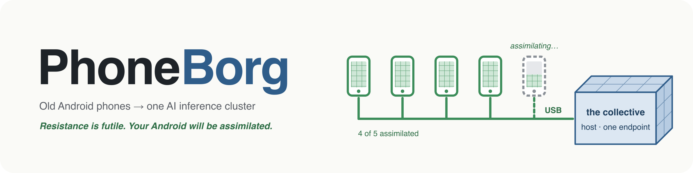
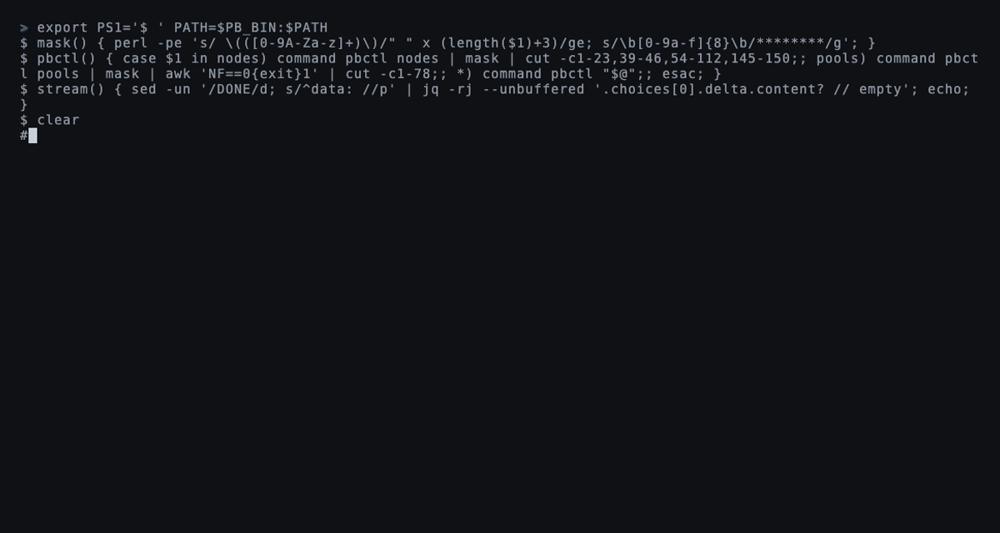
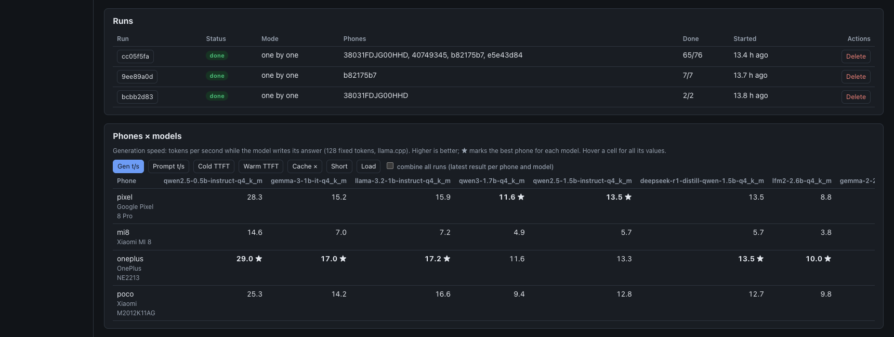
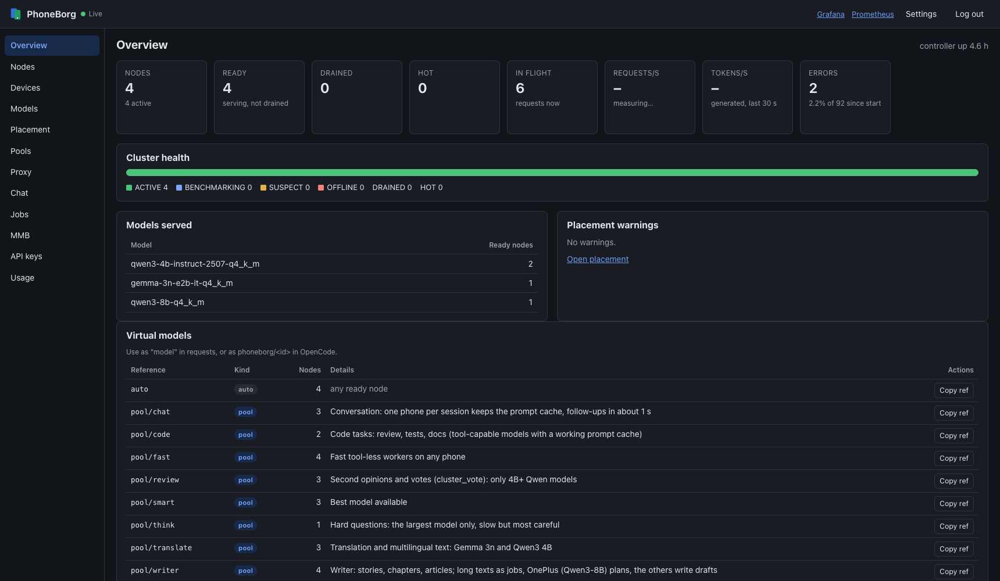

<p align="center">
  
</p>

<p align="center">
  <a href="https://github.com/dzaczek/phoneborg/actions/workflows/ci.yml"></a>
  <a href="LICENSE"></a>
  
  
  <a href="docs/BENCHMARKS.md"></a>
</p>

<p align="center">
  
</p>

**Turn a drawer full of old Android phones into an AI inference cluster.**

> *We are PhoneBorg. Your phones will be added to the collective. Their
> tokens will be added to our own.*

## Overview

Plug phones into a Linux or macOS host over USB. PhoneBorg installs a small
node agent on each phone over adb; the phone benchmarks itself, joins the
cluster and serves a GGUF model with
[llama.cpp](https://github.com/ggml-org/llama.cpp). Clients talk to **one
OpenAI-compatible endpoint**. The controller decides which phone serves which
model, routes each request to a phone, fails over when one freezes, and
exports everything to Prometheus and Grafana.

[![PhoneBorg at a glance: API clients and operators call the controller on :18080 (and Ollama apps on :11434). The controller is one Go process with the gateway, registry, catalog and placement, admin API and web panel, Big Brain head and /metrics. pcprov watches USB and provisions phones through the adb server. Requests reach each phone's llama-server through adb forward to :18090; phones register, heartbeat and download models through adb reverse :18080. Prometheus scrapes /metrics every 5 s and Grafana shows three dashboards.](assets/diagrams/overview-pipeline.png)](assets/diagrams/src/overview-pipeline.svg)

> **Status: proof of concept.** It runs end to end on a production cluster of
> five phones and on emulated phones. APIs, metrics and file layout will
> change. Parts of the API are unauthenticated in v0: do not expose it to
> untrusted networks.

## Contents

- [Cluster modes](#cluster-modes)
- [One phone per request](#one-phone-per-request)
- [Pools and Super Borg](#pools-and-super-borg)
- [Jobs and agents](#jobs-and-agents)
- [Big Brain](#big-brain)
- [Model benchmark (MMB)](#model-benchmark-mmb)
- [Platform features](#platform-features)
- [Quick start](#quick-start)
- [Managing the cluster](#managing-the-cluster)
- [Documentation](#documentation)
- [Repository layout](#repository-layout)
- [Related work](#related-work)

## Cluster modes

[](assets/diagrams/src/modes-map.svg)

The same phones work in several modes at once: some serve `auto`, some form
pools, others become a Super Borg or a Big Brain. Every number was measured
on real hardware unless marked *emulated*; setups and methods are in
[BENCHMARKS.md](docs/BENCHMARKS.md), pros and cons in
[CONCEPTS.md](docs/CONCEPTS.md#modes-at-a-glance).

| Mode | Request `model` | What the phones do | Headline result |
|---|---|---|---|
| [One phone per request](docs/CONCEPTS.md#1-a-model-auto-or-a-phone) | model id, `auto`, `node/<alias>` | the gateway picks one phone | 29 tok/s (0.5B), ~5 tok/s (4B) |
| [Semantic router](docs/OPERATIONS.md#semantic-router-experimental) | `auto` | one phone sorts the request into a class | 11 of 12 classified right, ~2 s each |
| [Pools](docs/CONCEPTS.md#2-pools) | `pool/<name>` | many requests at once, one phone each | 3 tasks in 9.9 s vs 23.8 s on one phone |
| [Super Borg](docs/CONCEPTS.md#3-super-borg-pool-with-a-phone-as-orchestrator) | `pool/<name>` (`superborg`) | an orchestrator splits one request across phones | ~2 min for a three-part request |
| [Jobs](docs/CONCEPTS.md#5-jobs) | `pbctl jobs` | long multi-step work in the background | 12 documents in ~70 min on 3 phones |
| [Agent + MCP](docs/CONCEPTS.md#6-an-agent-drives-the-cluster-opencode--mcp) | `pbctl mcp`, opencode | a strong model plans, the phones do the pieces | as pools and jobs |
| [Model benchmark](docs/CONCEPTS.md#7-benchmarks-to-choose-models-and-phones) | `pbctl mmb` | each phone measures every model that fits | 65 results, 19 models, 4 phones |
| [Big Brain](docs/CONCEPTS.md#8-big-brain-one-large-model-across-phones) | `pool/<name>` (`bigbrain`) | the phones hold **one** model too large for any of them | gpt-oss-20b at 2.8 tok/s, 30B MoE at 2.57 |

All modes except Big Brain make the cluster do **more at once** with models
that fit on one phone. Big Brain runs a **bigger model**, one request at a
time, and takes its phones out of the other modes.

Production cluster: Pixel 8 Pro (12 GB), OnePlus 10 Pro (12 GB), POCO F3 (8 GB), Xiaomi Mi 8 (6 GB), Xiaomi MI 9 (6 GB).

## One phone per request

[![Life of a request: auth checks the API key or access mode; the model is resolved from auto, a model id, node/alias or pool/name; the optional semantic router classifies auto requests; candidates are ACTIVE, ready, not drained phones whose context fits; the picker keeps a session on the same phone (affinity, pin 30 min), spills at 2 more requests in flight and avoids phones at 75 °C; the gateway forwards and streams. Early rejects are 401/403, 404 and 400. A phone that fails before the first byte is cooled down for 30 s and the request is retried once elsewhere, else 502 backends_failed or 503 busy.](assets/diagrams/gateway-routing.png)](assets/diagrams/src/gateway-routing.svg)

The gateway sends each request to the least busy, coolest phone. A session
stays on the phone that holds its prompt cache, and the gateway fails over
when a phone freezes. With the [semantic router](docs/OPERATIONS.md#semantic-router-experimental)
on, one phone first sorts each `auto` request into a class (easy chat,
coding, reasoning, …) and the gateway sends it to that class's pool or phone.

| Measurement | Result |
|---|---|
| Generation, OnePlus 10 Pro: 0.5B / 1.5B / 4B / 8B (Q4_K_M) | 29.0 / 13.3 / 4.6 / 2.9 tok/s |
| opencode, new session vs follow-up turn (session affinity, *emulated*) | 115 s vs 3 s |
| Freezing a phone under load (*emulated*) | 0 failed requests of 1138 |
| Semantic router, Pixel 8 Pro, Qwen3-4B, 6 classes | 11 of 12 right, 1.7–2.7 s per decision |

More: [models on the Mi 8](docs/BENCHMARKS.md#models-on-the-mi-8),
[failover](docs/BENCHMARKS.md#failover-under-load),
[affinity and the prompt cache](docs/BENCHMARKS.md#session-affinity-and-the-prompt-cache),
[router classifier](docs/BENCHMARKS.md#semantic-router-classifier).

## Pools and Super Borg

[![Super Borg: a client sends one chat request to pool/name with routing=superborg. The gateway hands it to an orchestrator phone, picked by tools-tagged model, then size, then speed, which gets a delegate tool. Delegated tasks run in parallel on worker phones (max_tokens 512, result up to 3000 bytes, retried once) and return as tool messages. After up to two delegation rounds a final round without tools must answer; progress streams as reasoning_content. An external orchestrator can take the orchestrator role.](assets/diagrams/superborg-delegate.png)](assets/diagrams/src/superborg-delegate.svg)

A **pool** is a named set of phones, chosen by alias, model, class or speed.
With `spread` routing, parallel requests each get their own phone. A
**Super Borg** pool answers as a single model: its orchestrator splits the
request into subtasks and the other phones work on them in parallel. The
orchestrator can be a phone or an external desktop or API model.

```sh
pbctl pools set fast nodes=pixel,poco,mi8                          # pool/fast: one phone per request
pbctl pools set writer routing=superborg nodes=oneplus,poco,pixel   # pool/writer: one answer from many phones
```

| Request | Setup | Time |
|---|---|---|
| Three tool-less agent tasks in parallel | `pool/fast` vs queued on `node/mi8` | 9.9 s vs 23.8 s |
| Three-part request (poem, translation, three facts) | Super Borg, Qwen3-4B orchestrator on the POCO, 2 workers | ~2 min |

Details: [pools](docs/CONCEPTS.md#2-pools),
[Super Borg](docs/CONCEPTS.md#3-super-borg-pool-with-a-phone-as-orchestrator),
[external orchestrator](docs/CONCEPTS.md#4-super-borg-pool-with-an-external-orchestrator),
[timings](docs/BENCHMARKS.md#super-borg-and-jobs-observed-timings).

## Jobs and agents

[![Super Borg jobs: a job starts from pbctl jobs new, the start_job tool in a Super Borg chat or MCP job_start. A queue on the controller runs one job at a time with its state on disk. Each step builds a compact job view, makes one stateless orchestrator call that must call exactly one tool (plan_tasks, delegate, write_doc, read_doc, ask_user, finish), and stores results as documents. delegate runs tasks in parallel on worker phones with models of 1.5B or more. A job waits on ask_user or after 80 steps, ends after finish is called twice, and fails after 5 failed steps in a row.](assets/diagrams/jobs-loop.png)](assets/diagrams/src/jobs-loop.svg)

A **job** is long, multi-step work on a Super Borg pool, with a task list and
documents that the controller keeps. With `pbctl mcp`, an agent such as
opencode uses the cluster as tools: ask a question, map tasks in parallel,
vote, and run jobs. A strong main model plans; the phones run the pieces.

```sh
pbctl jobs new pool=writer "A 12-chapter story about a lighthouse keeper"
pbctl opencode init        # opencode agents + the pbctl mcp server entry
```

| Work | Time |
|---|---|
| 12-document story (plan, outline, chapters) on 3 phones in parallel | ~70 min, 4 documents per phone |
| One orchestrator step, Qwen3-8B on the OnePlus, 2–3k-token prompt | 5–10 min |

Details: [jobs](docs/CONCEPTS.md#5-jobs),
[agent + MCP](docs/CONCEPTS.md#6-an-agent-drives-the-cluster-opencode--mcp),
[MCP tools](docs/OPERATIONS.md#the-cluster-as-mcp-tools).

## Big Brain

[![Big Brain: a client calls pool/brain. On the host, the gateway lets one request in at a time and sends a second concurrent one 503 busy. The head, llama-server built with RPC (--rpc phone1,phone2 -ngl 99 -ts), runs on 127.0.0.1:18200+, holds no weights and pushes them to the phones at load. Over USB and adb forward, each phone runs ggml-rpc-server and holds a slice of the layers sized by its free RAM minus 900 MiB; each token runs through the slices in order. A supervisor moves the pool through preparing, loading and ready, or error when the model does not fit.](assets/diagrams/bigbrain-rpc.png)](assets/diagrams/src/bigbrain-rpc.svg)

A Big Brain pool runs one catalog model that is too large for any single
phone, split across the RAM of several phones over llama.cpp RPC. Create one
from the panel with **Pools → Add Big Brain**, which shows whether the model
fits, or with `pbctl`:

```sh
pbctl pools set brain routing=bigbrain model=qwen3-30b-a3b-2507-ud-q3_k_xl nodes=pixel,oneplus
```

| Model | Phones | Speed | Load |
|---|---|---|---|
| gpt-oss-20b MXFP4 (12.1 GB, MoE) | 2 | **2.6–2.8** tok/s | 9 min |
| Qwen3-30B-A3B Q3 (13.8 GB, MoE) | 2 / 5 | **2.57** / 1.66 tok/s | 4–11 min |
| Qwen3-32B Q4_K_M (19.8 GB, dense) | 4 / 5 | 0.89 / 0.75 tok/s | 12 min |

Adding phones makes the model slower, because every token passes through the
phones in sequence: use the fewest, largest phones the model fits on, and
prefer MoE models. Full results:
[BENCHMARKS.md](docs/BENCHMARKS.md#big-brain-one-model-across-phones) and
[issue #6](https://github.com/dzaczek/phoneborg/issues/6).

## Model benchmark (MMB)

MMB loads every model that fits on the chosen phones and measures load time,
time to first token, prompt and generation speed on each. In the 4-phone run,
19 models produced 65 results with no failures
([tables](docs/BENCHMARKS.md#multi-model-benchmark-four-phones)).



## Platform features

| Feature | What it does |
|---|---|
| Zero-touch provisioning | `pcprov watch` provisions each phone when it is plugged in, picks the fastest llama.cpp build its CPU supports and restores dropped adb links |
| Runtime-discovered inventory | the agent reads SoC, cores, RAM, battery and temperature at runtime; nothing is hard-coded per phone model |
| Node lifecycle | heartbeats move each phone through `BENCHMARKING → ACTIVE → SUSPECT → OFFLINE`, and it recovers automatically |
| One OpenAI-compatible gateway | chat and completions with streaming, session affinity, failover, and routing that avoids hot and slow phones; Ollama API too |
| Model catalog and placement | add GGUFs from Hugging Face; phones download them over USB and switch, sized to their RAM |
| Performance tiers | each phone's measured bandwidth predicts each model's speed and keeps too-slow placements away |
| Management | `pbctl` CLI and a built-in web panel: drain, aliases, pools, API keys (stored hashed), gateway settings, usage per key and node |
| External engine nodes | a Mac or PC running LM Studio, oMLX, Ollama or llama-server joins behind the same gateway |
| Observability | JSON logs, `phoneborg_*` metrics and Grafana dashboards, also inside the panel |
| Test without phones | emulated Android phones (redroid) driven through real adb |



More screenshots of the web panel and Grafana: [OPERATIONS.md](docs/OPERATIONS.md#screenshots).

## Quick start

[](assets/diagrams/src/install-flow.svg)

**One command on Debian or Ubuntu** (a PC, a NUC or a VM with USB
passthrough). It installs everything, starts the services and prints the
panel's address. Run it as your normal user, not root:

```sh
curl -fsSL https://raw.githubusercontent.com/dzaczek/phoneborg/main/deploy/install.sh | bash -s -- host
```

Use `docker` instead of `host` to run the same cluster in Docker containers.
Then turn on USB debugging on a phone, plug it in and tap **Allow**. You
install nothing on the phone yourself: the provisioner pushes the agent,
llama.cpp and a first model over USB. Details:
[INSTALL.md](docs/INSTALL.md#installer). Step by step instead:
[QUICKSTART.md](docs/QUICKSTART.md) (a test cluster with one or two phones)
or [INSTALL.md](docs/INSTALL.md) (a permanent install as services).

Phones: ARM64 Android with 4 GB RAM or more; which phones and models fit:
[REAL_PHONES.md](docs/REAL_PHONES.md). **Emulated phones** with Prometheus
and Grafana ([DEV_EMULATION.md](docs/DEV_EMULATION.md)):

```sh
make agent pcprov cluster-up
make e2e                                      # provisioning, serving, failover, recovery
```

## Managing the cluster

Everything the web panel does, `pbctl` does from the console. Set it up once
on the host:

```sh
export PATH=$PATH:/srv/phoneborg/app/bin
export PHONEBORG_ADMIN_TOKEN=$(cat /srv/phoneborg/admin-token)
```

```sh
pbctl nodes                                   # every phone: state, model, tok/s
pbctl nodes alias <id> pixel                  # address it as node/pixel
pbctl models add hf://Qwen/Qwen2.5-1.5B-Instruct-GGUF/qwen2.5-1.5b-instruct-q4_k_m.gguf
pbctl placement set qwen2.5-1.5b-instruct-q4_k_m replicas=2
pbctl pools set fast nodes=pixel,poco,mi8     # clients call model "pool/fast"
pbctl keys create laptop                      # an API key for a remote client
pbctl drain pixel                             # maintenance: finish, take nothing new
```

The [pbctl guide](docs/PBCTL.md) has step-by-step recipes for each task:

| I want to… | Guide |
|---|---|
| check the cluster and name the phones | [Check the cluster](docs/PBCTL.md#check-the-cluster-and-name-the-phones) |
| add a model and put it on phones | [Add a model](docs/PBCTL.md#add-a-model-and-put-it-on-phones) |
| run parallel agents on a pool | [A pool for parallel agents](docs/PBCTL.md#a-pool-for-parallel-agents) |
| get one answer from many phones, or run a long job | [Super Borg and jobs](docs/PBCTL.md#one-answer-from-many-phones-and-long-jobs) |
| run a model bigger than any phone | [Big Brain](docs/PBCTL.md#a-model-bigger-than-any-phone) |
| let other machines use the gateway | [API keys](docs/PBCTL.md#let-other-machines-use-the-gateway) |
| take a phone out for maintenance | [Drain](docs/PBCTL.md#take-a-phone-out-for-maintenance) |
| route `auto` by difficulty | [Semantic router](docs/PBCTL.md#route-auto-by-difficulty) |
| pick the best model for each phone | [MMB](docs/PBCTL.md#pick-the-best-model-for-each-phone) |
| use the cluster from opencode | [opencode](docs/PBCTL.md#use-the-cluster-from-opencode) |

Every command is in the [command reference](docs/PBCTL.md#command-reference).
The drones do not need to be asked twice.

## Documentation

| Document | For |
|---|---|
| [docs/README.md](docs/README.md) | index by audience and task |
| [docs/QUICKSTART.md](docs/QUICKSTART.md) | fast track: a test cluster with one or two phones |
| [docs/CONCEPTS.md](docs/CONCEPTS.md) | ways to use the cluster, with pros, cons and measured numbers |
| [docs/REAL_PHONES.md](docs/REAL_PHONES.md) | choosing, preparing, provisioning and troubleshooting real phones |
| [docs/OPERATIONS.md](docs/OPERATIONS.md) | running the cluster: requests, web panel, `pbctl`, models, pools, keys, monitoring |
| [docs/PBCTL.md](docs/PBCTL.md) | every `pbctl` command, grouped by task, with examples |
| [docs/DEV_EMULATION.md](docs/DEV_EMULATION.md) | developer environment with emulated phones, e2e and load tests |
| [docs/ARCHITECTURE.md](docs/ARCHITECTURE.md) | how it works: components, routing, placement, ports, security |
| [docs/BENCHMARKS.md](docs/BENCHMARKS.md) | every measurement, with setup and method |
| [docs/DECISIONS.md](docs/DECISIONS.md) | architecture decision records (ADR-001..034) |

## Repository layout

```text
controller/            control plane: registry, HTTP API, admin API, usage, metrics, placement
controller/gateway     OpenAI-compatible proxy: auth, targets, pickers, failover
controller/models      model catalog, GGUF metadata, planner, performance tiers
controller/ui          web panel (static files embedded in the controller)
controller/cmd/pbctl   admin CLI
node-agent/            on-phone agent: inventory, benchmark, heartbeats, runtime, model manager
provisioner/           pcprov: adb provisioning, hot-plug watch, heal, slim
internal/memplan       memory sizing shared by agent and planner
proto/                 controller <-> node wire types (JSON v0)
runtime/llama/         static arm64 llama.cpp build
deploy/                installer, systemd units, docker compose, Prometheus, Grafana
tests/                 end-to-end test, LLM smoke test, load generator
assets/                README diagrams (SVG sources in assets/diagrams/src) and the demo GIF
docs/                  guides, architecture, benchmarks, ADRs
```

## Related work

- [AI models may be capable of self-replicating without access to a datacenter](https://www.anthropic.com/research/self-replicating-ai)
  (Anthropic Frontier Red Team, 2026-10-12). A safety study of models
  spreading across cheap, poorly secured devices. Its demo splits a 26B model
  over 15 off-brand Android TV boxes (~$55 each), the same layer-split idea
  as [Big Brain](#big-brain). It is also a reminder of why PhoneBorg keeps
  phones on USB, the gateway local by default and adb off the network.
- [llama.cpp](https://github.com/ggml-org/llama.cpp): the inference engine on
  every phone, and its RPC backend behind Big Brain.

## License

[Apache License 2.0](LICENSE).
